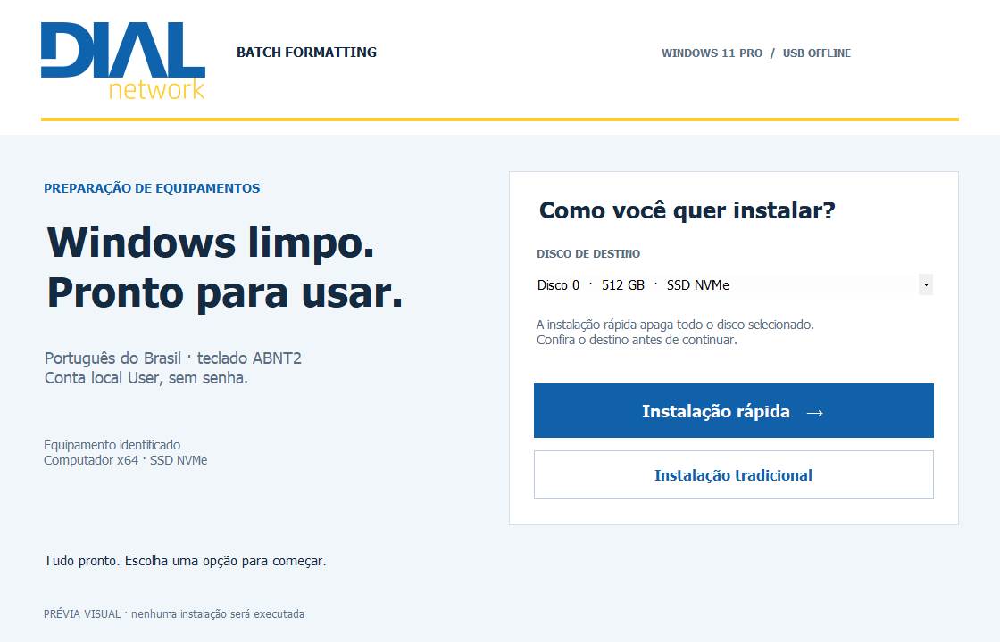

# Pendrive com menu da Dial

O modo USB funciona sem rede: o boot fica na particao FAT32 e os arquivos originais do Windows ficam na particao NTFS. O menu e uma aplicacao grafica nativa para WinPE, com logo da Dial e indicador animado durante a preparacao. `winpeshl.ini` inicia a aplicacao diretamente, sem abrir o prompt de comando no fluxo normal.



## Como usar

1. Iniciar o computador pelo pendrive em **UEFI x64**.
2. Aguardar a identificacao da midia e dos discos. Nenhuma instalacao comeca so por conectar ou iniciar pelo USB.
3. Escolher uma opcao:
   - **Instalacao rapida:** selecionar o disco interno, clicar e confirmar na janela grafica. O instalador apaga esse disco, cria as particoes e instala Windows 11 Pro pt-BR com `User` sem senha.
   - **Instalacao tradicional:** abre o Windows Setup grafico para escolher o destino manualmente, mantendo a configuracao da edicao Pro e da conta `User`.
4. O Windows Setup mostra suas proprias telas de progresso e pode apresentar erros ou pedidos de drivers. O menu da Dial nao cobre nem oculta essas telas.
5. Nos reinicios, iniciar pelo SSD / Windows Boot Manager. Se iniciar novamente pelo pendrive, o menu reaparece; ele nao formata automaticamente outra vez.

## Computadores atendidos

**Desktops montados e notebooks, sem filtro de marca ou modelo.** Nao ha restricao a Lenovo/ThinkPad. A midia e Windows 11 Pro **x64**, exige boot UEFI e continua sujeita aos requisitos de hardware do Windows. Nao inclui Windows ARM64, suporte a BIOS Legacy nem bypass de TPM/CPU/RAM.

O disco do pendrive e qualquer disco USB sao excluidos do destino rapido. Discos internos abaixo de 64 GB, offline ou somente leitura tambem sao excluidos. Se houver varios discos internos, o operador precisa escolher um deles. A identidade do disco e do pendrive e reconferida antes de abrir o Setup. Quando configurada, a protecao por UUID do computador que preparou a midia e preservada.

Os drivers genericos da midia cobrem diversos equipamentos; VMD/RAID, placas de rede e outros componentes especificos podem exigir pacotes do fabricante. A opcao tradicional permite seguir pelas telas de selecao/carregamento de drivers do Windows Setup.

## Construir a interface

```powershell
.\scripts\Build-UsbGui.ps1
.\.local\usb-gui\DialDeploy.exe --preview
```

`--preview` e somente uma demonstracao visual: usa disco ficticio e nao executa o backend ou o instalador. A compilacao usa o compilador .NET Framework do proprio Windows. O WinPE precisa ja conter WinPE-NetFX, PowerShell, WMI, StorageWMI e SecureStartup. A midia USB modificada nesta sessao ja possuia esses componentes.

## Atualizar um pendrive DNW existente

Descobrir as letras e o serial primeiro. O comando abaixo usa parametros a preencher com os dados do USB correto; nao formata nem reparticiona a unidade:

```powershell
Get-Disk | Select-Object Number, FriendlyName, SerialNumber, BusType
Get-Partition | Select-Object DiskNumber, PartitionNumber, DriveLetter
.\scripts\Update-UsbGui.ps1 -BootDrive D -MediaDrive E -ExpectedDiskSerial 'SERIAL_REAL_DO_USB' -WimlibPath 'CAMINHO_DO_WIMLIB\wimlib-imagex.exe'
```

Usar o [wimlib oficial](https://wimlib.net/downloads/), versao 1.14.5 ou compativel. O atualizador verifica que as duas particoes pertencem ao mesmo USB e que ele nao e o disco de sistema, faz backup, altera uma copia local do boot, verifica a imagem e os arquivos incluidos, copia para o pendrive e verifica os hashes antes de substituir o boot ativo. Os arquivos do Windows, as particoes e o diretorio `State` sao preservados.

O boot anterior fica em `sources\boot.before-dial-menu-DATA.wim`, alem de uma copia local em `.local\usb-updates\...\backup`. Para voltar ao anterior, com o USB desconectado de qualquer instalacao em andamento, renomear o boot atual para um nome de arquivo de reserva e renomear a copia anterior para `boot.wim`. Restaurar tambem o descritor JSON a partir do backup local se desejar retornar a configuracao anterior completa.

## Validacao realizada

- Compilacao da interface x64 e renderizacao de previa no Windows.
- Testes de selecao de disco interno NVMe/SATA, exclusao de USB/midia de origem e rejeicao de discos inadequados.
- Recusa do backend quando executado fora do WinPE.
- Verificacao integral do WIM alterado com wimlib, comparacao dos arquivos extraidos e verificacao de SHA-256 apos a copia ao pendrive.

**Ainda falta testar o boot da interface e uma instalacao no hardware de destino.** Uma previa no Windows e a verificacao do arquivo WIM nao substituem esse teste. Os logs tecnicos ficam em `X:\DNW` durante o boot e os registros de inicio em `State\Gui` no USB; eles nao aparecem como console no fluxo normal.

Referencias: [Microsoft — shell grafico do WinPE](https://learn.microsoft.com/en-us/windows-hardware/manufacture/desktop/winpeshlini-reference-launching-an-app-when-winpe-starts?view=windows-11), [componentes opcionais](https://learn.microsoft.com/en-us/windows-hardware/manufacture/desktop/winpe-add-packages--optional-components-reference?view=windows-11) e [Windows Setup](https://learn.microsoft.com/en-us/windows-hardware/manufacture/desktop/windows-setup-command-line-options?view=windows-11). O parametro `/Quiet` nao e suportado para Setup iniciado pelo WinPE, por isso o kit preserva o progresso grafico e os avisos do instalador original.
